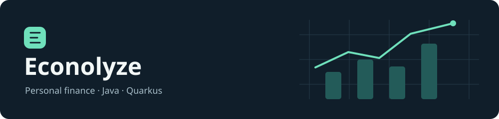
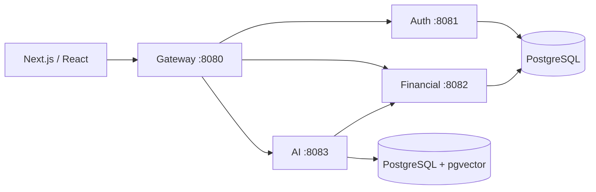

# Econolyze

Português: [README_pt.md](README_pt.md)



Econolyze is a personal finance application with a Next.js web interface and four Quarkus backend services. It brings together accounts, transactions, payments, recurring entries, financial goals, reports, CDI investment projections, and an AI financial assistant.

The project explores the practical work behind a finance backend: keeping monetary calculations explicit, separating authentication from financial operations, coordinating service calls, and providing an assistant with access to financial data. It is an existing application under development, with limitations documented below.

## Technology and architecture

All backend services target **Java 21**. Auth, financial, and gateway use **Quarkus 3.32.2**; AI uses **3.34.6**. These versions are retained deliberately. Maven builds each service independently; there is no root Maven reactor.



| Service | Responsibility | Implementation |
| --- | --- | --- |
| `gateway-service` | Public API, downstream clients, response aggregation | Jakarta REST, Mutiny, JWT, REST Client |
| `auth-service` | Registration, login, refresh rotation, logout | Blocking Hibernate ORM/Panache, BCrypt, RSA JWT |
| `financial-service` | Accounts, balances, transactions, payments, goals, recurrence, reports, CDI | Hibernate Reactive/Panache, PostgreSQL, MapStruct, scheduled CDI refresh |
| `ai-service` | Financial chat, retrieval and financial tools | LangChain4j, Groq chat, Gemini embeddings, pgvector |

The financial service retains its existing `application`, `domain`, `infrastructure`, and `interfaces` packages. Other services retain their own package conventions. Reactive persistence uses `@WithSession` and `@WithTransaction`; authentication uses Jakarta transactions. These approaches are intentionally separate.

Immutable DTOs use records with canonical constructors and component accessors. Transaction, investment projection, and goal-progress DTOs retain classes because the current services mutate them during processing. JPA entities retain no-argument constructors and identity equality. DTOs and entities use constructors instead of builders. Monetary storage uses PostgreSQL `NUMERIC(19,4)`; projections retain their existing rounding policies and floating-point exponentiation. No migration history or financial formulas were changed during the technical review.

## Features and API

The backend implements registration, JWT login/refresh/logout, account and transaction management, payments, recurring templates, goals and progress, dashboard aggregation and investment projections. AI tools query financial data and provide simple calculations; chat requires external model providers.

Representative gateway routes:

- `/api/auth`: registration, login, refresh, logout.
- `/api/account` and `/api/account/balance`: accounts and consolidated balances.
- `/api/transaction`, `/api/financial/payment`, `/api/financial/recurring`: financial activity.
- `/api/goal`, `/api/dashboard`, `/api/investment`: goals, summaries, projections.
- `/api/ai/chat`: financial assistant.
- `/api/ping`: gateway liveness response.

Gateway Swagger UI is configured at `/swagger-ui`; OpenAPI is available at `/q/openapi`. Consult the resource classes and generated OpenAPI for exact request contracts. Internal financial routes require a service token; they are not a public client API.

## Requirements and configuration

Use Java 21 and Maven (or the wrapper in each service, invoked with `bash mvnw` if it is not executable). PostgreSQL is required for auth and finance; AI additionally requires pgvector with permission to create the vector extension. Container-backed integration tests require a Docker-compatible runtime.

Supply configuration through environment variables or an untracked `.env` in each service working directory. Never commit credentials or private keys.

| Variable | Used by | Meaning |
| --- | --- | --- |
| `DB_USERNAME`, `DB_PASSWORD` | Auth, finance, AI | Database credentials |
| `DB_JDBC_URL` | Auth, finance, AI | JDBC URL, e.g. `jdbc:postgresql://localhost:5432/econolyze` |
| `DB_URL` | Finance, AI | Reactive URL, e.g. `postgresql://localhost:5432/econolyze` |
| `DB_HOST`, `DB_PORT`, `DB_NAME` | AI | pgvector connection details |
| `INTERNAL_SECRET` | Finance, AI | Shared service-token signing secret; use a securely generated value of at least 32 bytes |
| `BANCO_CENTRAL_API_URL` | Finance | Banco Central API base URL, `https://api.bcb.gov.br` |
| `GROQ_API_KEY`, `GEMINI_API_KEY` | AI | External provider credentials |
| `AUTH_SERVICE_URL`, `FINANCIAL_SERVICE_URL`, `AI_SERVICE_URL` | Gateway | Downstream base URLs; set localhost URLs for local service processes |

Database configuration requires TLS by default (`sslmode=require`). For a local database without TLS, override `QUARKUS_DATASOURCE_JDBC_ADDITIONAL_JDBC_PROPERTIES_SSLMODE=disable` for local development only. Provision the database separately: **`services/compose.yaml` deploys service images and does not create a database**. It expects `/opt/econolyze/.env`, key and TLS mounts, and maps gateway ports to 80/443.

Generate and protect an RSA signing key outside the repository. Configure auth's signing key through `SMALLRYE_JWT_SIGN_KEY_LOCATION` and each verifying service through `MP_JWT_VERIFY_PUBLICKEY_LOCATION`; the checked-in configuration points to `keys/privateKey.pem` and `keys/publicKey.pem`, which are not supplied. Use matching keys and the existing `econolyze` issuer.

The gateway uses TLS files under `/work/ssl`; the corrected certificate properties now load those files. Override paths with `TLS_CERTIFICATE_FILES` and `TLS_KEY_FILES`, or clear `quarkus.http.ssl.certificate.files` and `quarkus.http.ssl.certificate.key-files` for a local HTTP-only run. AI's financial client defaults to the container hostname; set `QUARKUS_REST_CLIENT_FINANCIAL_SERVICE_URL=http://localhost:8082` when running locally.

## Database migrations

Flyway runs at startup, using separate schemas and history tables:

- Auth: `authentication`, migration `V1.0.0`.
- Finance: `finance`, migration `V1.1.0`.
- AI: `ai`, migration `V1.2.0`, including `vector(768)` columns.

Keep existing migrations immutable once applied. AI currently enables Flyway repair at startup; review that setting before production use. Database credentials need the privileges required by these migrations. Financial user IDs are logical references across service boundaries, rather than foreign keys into the authentication schema.

## Running and building

Start each service in its own terminal from the repository root, after configuring its environment:

```bash
mvn -f services/auth-service/pom.xml quarkus:dev
mvn -f services/financial-service/pom.xml quarkus:dev
mvn -f services/ai-service/pom.xml quarkus:dev
mvn -f services/gateway-service/pom.xml quarkus:dev
```

For example, build one service and run its packaged application:

```bash
mvn -f services/financial-service/pom.xml clean verify
java -jar services/financial-service/target/quarkus-app/quarkus-run.jar
```

Quarkus Dev UI is available at `/q/dev/` in development mode. The frontend uses Next.js 16, React 19, TypeScript, Tailwind CSS 4, Radix UI, React Hook Form, Zod, and Recharts. Its existing workflow remains:

```bash
cd econolyze-front-end
npm install
npm run dev
```

Frontend scripts also include `build`, `start`, and `lint`. The application runs on port 3000. Review `next.config.ts` for its API base URL before connecting it to a different backend environment.

## Tests and coverage

Run the standard checks for every backend service:

```bash
for service in auth-service financial-service gateway-service ai-service; do
    mvn -f "services/$service/pom.xml" clean verify || break
done
```

The suite uses JUnit Jupiter, Mockito for isolated financial service tests, and Quarkus tests with REST Assured for gateway HTTP checks. Tests cover investment compounding and rejected inputs, fractional goal progress, completed-payment totals and transaction states, payment rejection paths, CDI API fallback, token-safe diagnostics, and AI calculation tools. They do not establish comprehensive financial or security coverage.

Run the PostgreSQL integration suite explicitly:

```bash
mvn -f services/financial-service/pom.xml -Pintegration clean verify
```

This uses `@QuarkusTest` with a Testcontainers PostgreSQL 17 instance and the actual Flyway migration. It checks category HTTP responses, rejection of missing internal credentials, monetary persistence precision, and JDBC rollback isolation. The three scenarios passed locally through Podman’s Docker-compatible API. The suite requires container support and image access; it does not use an in-memory substitute. Hibernate Reactive write transactions, authenticated user flows, and concurrent payment behavior still require additional integration tests.

JaCoCo produces `target/site/jacoco/index.html` and `jacoco.xml` in each service after `verify` when execution data exists. Coverage is a measurement of executed code, not evidence that all business cases are correct. Gateway runtime class loading can affect standard-agent coverage; see the [technical review](docs/backend-review.md) for measured results and limitations.

## Project structure

```text
README.md
README_pt.md
README_en.md
docs/backend-review.md
econolyze-front-end/
services/
  compose.yaml
  auth-service/
  financial-service/
  gateway-service/
  ai-service/
```

## Known limitations

Reporting and budgeting remain incomplete: `ReportService` and `BudgetService` are placeholders, and `/api/report` returns the literal string `report`.

The [backend review](docs/backend-review.md) records prioritized findings and verification results. Ownership checks are inconsistent on some ID-based lookups. Cookie authentication and CSRF handling need a dedicated review. Payment aggregation has inconsistent status filtering and a potentially stale cached total; concurrent updates and zero-principal investment projections also need work. Request validation and error responses vary between resources. These issues require explicit decisions and tests before changing public behavior.

No dependency versions were upgraded as part of the review. Dependency vulnerability scanning, full authentication flows, AI provider integration, scheduler behavior, and concurrency testing remain follow-up work. This repository should not be treated as production-hardened solely because it builds.

## Continuous integration and deployment

[Validate backend](.github/workflows/validate-backend.yml) runs on pushes and pull requests. It builds and tests all four backend services, runs the financial PostgreSQL integration suite, and uploads test and coverage reports. Validation uses read-only repository permissions and does not publish images or deploy.

[Deploy Back-End (Quarkus)](.github/workflows/deploy-backend.yml) runs only through **Actions → Deploy Back-End (Quarkus) → Run workflow**. It first runs backend validation, then follows the existing image-publishing and server-deployment steps. Commits and pushes do not automatically start deployment. The deployment itself and native images have not been tested locally.
