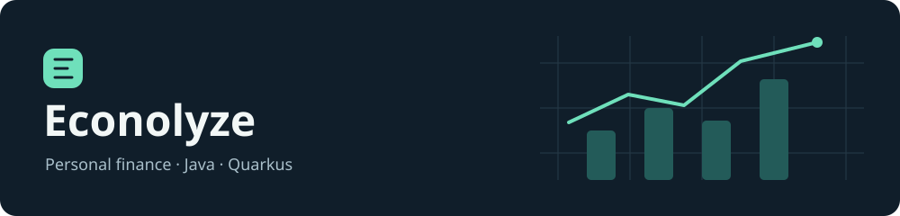
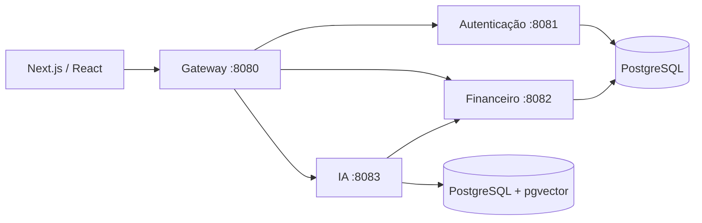

# Econolyze

English: [README.md](README.md)



Econolyze é uma aplicação de gestão financeira pessoal com interface web em Next.js e quatro serviços de backend em Quarkus. O projeto reúne contas, transações, pagamentos, recorrências, metas financeiras, relatórios, projeções de investimento baseadas no CDI e um assistente financeiro com IA.

O objetivo é explorar os desafios de um backend financeiro: cálculos monetários explícitos, autenticação separada das operações financeiras, comunicação entre serviços e acesso a dados financeiros por um assistente. É uma aplicação existente em desenvolvimento, com limitações conhecidas descritas abaixo.

## Tecnologias e arquitetura

Todos os serviços usam **Java 21**. Autenticação, financeiro e gateway usam **Quarkus 3.32.2**; IA usa **3.34.6**. As versões foram mantidas. Cada serviço possui seu próprio projeto Maven; não existe um agregador Maven na raiz.



| Serviço | Responsabilidade | Implementação |
| --- | --- | --- |
| `gateway-service` | API pública, clientes HTTP e agregação de respostas | Jakarta REST, Mutiny, JWT, REST Client |
| `auth-service` | Cadastro, login, renovação e revogação de tokens | Hibernate ORM/Panache, BCrypt, JWT com RSA |
| `financial-service` | Contas, saldos, transações, pagamentos, metas, recorrências, relatórios e CDI | Hibernate Reactive/Panache, PostgreSQL, MapStruct, agendador |
| `ai-service` | Chat financeiro, recuperação de dados e ferramentas de cálculo | LangChain4j, Groq, Gemini Embeddings, pgvector |

O serviço financeiro mantém os pacotes `application`, `domain`, `infrastructure` e `interfaces`. Os demais serviços preservam suas próprias convenções. A persistência reativa utiliza `@WithSession` e `@WithTransaction`; a autenticação utiliza transações Jakarta.

DTOs imutáveis utilizam records com construtores canônicos e métodos de acesso aos componentes. Os DTOs de transação, projeção de investimento e progresso de metas continuam como classes porque os serviços atuais os modificam durante o processamento. Entidades JPA mantêm construtores sem argumentos e igualdade por identidade. DTOs e entidades utilizam construtores em vez de builders.

Os valores monetários são armazenados em colunas PostgreSQL `NUMERIC(19,4)`. As projeções mantêm as políticas de arredondamento e a exponenciação em ponto flutuante já existentes. A revisão não alterou o histórico de migrações nem as fórmulas financeiras.

## Funcionalidades e API

O backend implementa cadastro, login e renovação de JWT, logout, contas, transações, pagamentos, modelos de recorrência, metas e progresso, dashboards e projeções de investimento. O chat depende de provedores externos; suas ferramentas consultam dados financeiros e realizam cálculos simples.

Principais grupos de rotas do gateway:

- `/api/auth`: cadastro, login, renovação e logout.
- `/api/account` e `/api/account/balance`: contas e saldo consolidado.
- `/api/transaction`, `/api/financial/payment`, `/api/financial/recurring`: movimentações financeiras.
- `/api/goal`, `/api/dashboard`, `/api/investment`: metas, indicadores e projeções.
- `/api/ai/chat`: assistente financeiro.
- `/api/ping`: verificação de resposta do gateway.

O Swagger UI do gateway está configurado em `/swagger-ui` e o OpenAPI em `/q/openapi`. Consulte os recursos REST e o OpenAPI gerado para os contratos exatos. Rotas financeiras internas exigem token de serviço e não constituem uma API pública para o frontend.

## Requisitos e configuração

Utilize Java 21 e Maven, ou o wrapper de cada serviço (`bash mvnw` quando o arquivo não tiver permissão de execução). Autenticação e financeiro precisam de PostgreSQL. A IA também precisa de pgvector e permissão para criar a extensão. Os testes com containers exigem um ambiente compatível com Docker.

Forneça a configuração por variáveis de ambiente ou por um `.env` não versionado no diretório de execução de cada serviço. Nunca versione credenciais ou chaves privadas.

| Variável | Serviços | Finalidade |
| --- | --- | --- |
| `DB_USERNAME`, `DB_PASSWORD` | Auth, financeiro, IA | Credenciais do banco |
| `DB_JDBC_URL` | Auth, financeiro, IA | URL JDBC, como `jdbc:postgresql://localhost:5432/econolyze` |
| `DB_URL` | Financeiro, IA | URL reativa, como `postgresql://localhost:5432/econolyze` |
| `DB_HOST`, `DB_PORT`, `DB_NAME` | IA | Conexão do pgvector |
| `INTERNAL_SECRET` | Financeiro, IA | Segredo compartilhado para tokens internos; gere um valor seguro com pelo menos 32 bytes |
| `BANCO_CENTRAL_API_URL` | Financeiro | URL base do Banco Central: `https://api.bcb.gov.br` |
| `GROQ_API_KEY`, `GEMINI_API_KEY` | IA | Credenciais dos provedores externos |
| `AUTH_SERVICE_URL`, `FINANCIAL_SERVICE_URL`, `AI_SERVICE_URL` | Gateway | URLs dos serviços; utilize localhost ao executar processos locais |

A conexão JDBC exige TLS por padrão (`sslmode=require`). Para um banco local sem TLS, configure `QUARKUS_DATASOURCE_JDBC_ADDITIONAL_JDBC_PROPERTIES_SSLMODE=disable` somente no desenvolvimento local.

Provisione o banco separadamente: **`services/compose.yaml` executa imagens dos serviços e não cria um banco de dados**. O arquivo espera `/opt/econolyze/.env`, diretórios de chaves e certificados, e publica o gateway nas portas 80/443.

Gere e proteja uma chave RSA fora do repositório. Configure a chave privada do auth com `SMALLRYE_JWT_SIGN_KEY_LOCATION` e a chave pública dos serviços com `MP_JWT_VERIFY_PUBLICKEY_LOCATION`. A configuração existente aponta para `keys/privateKey.pem` e `keys/publicKey.pem`, que não são fornecidos. Utilize chaves correspondentes e o emissor `econolyze`.

O gateway utiliza certificados em `/work/ssl`; as propriedades corrigidas agora carregam esses arquivos. Utilize `TLS_CERTIFICATE_FILES` e `TLS_KEY_FILES` para alterar os caminhos, ou esvazie `quarkus.http.ssl.certificate.files` e `quarkus.http.ssl.certificate.key-files` para execução local apenas por HTTP. Para a IA acessar o financeiro fora dos containers, configure `QUARKUS_REST_CLIENT_FINANCIAL_SERVICE_URL=http://localhost:8082`.

## Banco de dados e migrações

O Flyway executa na inicialização, com schemas e tabelas de histórico separados:

- Auth: `authentication`, migração `V1.0.0`.
- Financeiro: `finance`, migração `V1.1.0`.
- IA: `ai`, migração `V1.2.0`, com colunas `vector(768)`.

Não altere migrações já aplicadas. A IA habilita reparo automático do Flyway na inicialização; revise essa configuração antes de produção. O usuário do banco precisa das permissões exigidas pelas migrações. Os IDs de usuários no financeiro são referências lógicas entre serviços, sem chave estrangeira para o schema de autenticação.

## Execução e build

Após configurar o ambiente, execute cada comando em um terminal separado, a partir da raiz:

```bash
mvn -f services/auth-service/pom.xml quarkus:dev
mvn -f services/financial-service/pom.xml quarkus:dev
mvn -f services/ai-service/pom.xml quarkus:dev
mvn -f services/gateway-service/pom.xml quarkus:dev
```

Exemplo de build e execução do serviço financeiro:

```bash
mvn -f services/financial-service/pom.xml clean verify
java -jar services/financial-service/target/quarkus-app/quarkus-run.jar
```

Em desenvolvimento, o Quarkus Dev UI fica em `/q/dev/`. O frontend utiliza Next.js 16, React 19, TypeScript, Tailwind CSS 4, Radix UI, React Hook Form, Zod e Recharts:

```bash
cd econolyze-front-end
npm install
npm run dev
```

A interface utiliza a porta 3000. Os scripts também incluem `build`, `start` e `lint`. Revise a URL da API em `next.config.ts` antes de conectar a interface a outro ambiente.

## Testes e cobertura

Execute as verificações padrão de todos os serviços:

```bash
for service in auth-service financial-service gateway-service ai-service; do
    mvn -f "services/$service/pom.xml" clean verify || break
done
```

A suíte utiliza JUnit Jupiter, Mockito nos testes financeiros isolados e Quarkus com REST Assured nos testes HTTP do gateway. Os cenários incluem capitalização e validação das projeções, progresso de metas, totais de pagamentos concluídos, estados de transações, rejeição de pagamentos inválidos, fallback da API do CDI, proteção de tokens em mensagens de diagnóstico e cálculos das ferramentas de IA. Isso ainda não representa cobertura completa das regras financeiras ou de segurança.

Execute os testes de integração PostgreSQL explicitamente:

```bash
mvn -f services/financial-service/pom.xml -Pintegration clean verify
```

A suíte usa `@QuarkusTest`, PostgreSQL 17 via Testcontainers e a migração real do Flyway. Verifica categorias pela API, rejeição de chamadas internas sem credenciais, precisão monetária e isolamento por rollback JDBC. Os três cenários passaram localmente pela API do Podman compatível com Docker. A suíte exige acesso ao runtime de containers e à imagem PostgreSQL; não utiliza banco em memória como substituto. Transações de escrita do Hibernate Reactive, fluxos autenticados e pagamentos concorrentes ainda precisam de testes adicionais.

Quando há dados de execução, o JaCoCo gera `target/site/jacoco/index.html` e `jacoco.xml` após `verify`. Cobertura mede código executado; não comprova que todas as regras estejam corretas. O carregamento de classes do Quarkus pode afetar a medição por agente padrão no gateway. Os resultados e limites estão no [relatório técnico](docs/backend-review.md), em inglês.

## Estrutura

```text
README.md
README_pt.md
README_en.md
docs/backend-review.md
econolyze-front-end/
services/
  compose.yaml
  auth-service/
  financial-service/
  gateway-service/
  ai-service/
```

## Limitações conhecidas

Relatórios e orçamentos ainda estão incompletos: `ReportService` e `BudgetService` são estruturas sem implementação, e `/api/report` retorna a string literal `report`.

O [relatório técnico](docs/backend-review.md) apresenta os problemas priorizados e as verificações realizadas. Há consultas por ID com validação inconsistente de proprietário. O fluxo de cookies e CSRF precisa de revisão específica. A agregação de pagamentos utiliza critérios de status diferentes e possui um total em cache potencialmente desatualizado. Concorrência, projeções com principal zero, validação de entradas e padronização dos erros também exigem trabalho adicional e decisões explícitas antes de alterar o comportamento público.

Nenhuma dependência existente foi atualizada nesta revisão. Análise de vulnerabilidades, fluxos completos de autenticação, integração com provedores de IA, agendamentos e testes de concorrência continuam pendentes. Um build bem-sucedido não significa que a aplicação esteja pronta para produção.

## Integração contínua e deploy

O workflow [Validate backend](.github/workflows/validate-backend.yml) executa em pushes e pull requests. Ele compila e testa os quatro serviços, executa a integração PostgreSQL do financeiro e disponibiliza os relatórios. A validação utiliza permissões de leitura e não publica imagens nem realiza deploy.

O workflow [Deploy Back-End (Quarkus)](.github/workflows/deploy-backend.yml) executa somente por **Actions → Deploy Back-End (Quarkus) → Run workflow**. Primeiro valida o backend e depois segue as etapas existentes de publicação de imagens e atualização do servidor. Commits e pushes não iniciam o deploy automaticamente. O deploy e as imagens nativas não foram testados localmente.
